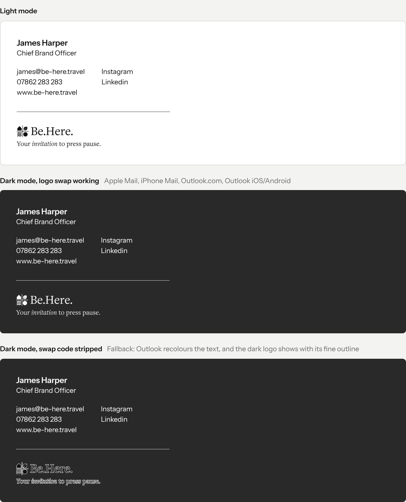

# Be.Here. email signature: implementation guide

One HTML email signature for Outlook, in both light and dark mode. It uses inline styles only: no `<style>` blocks, no scripts, no web fonts. This guide covers hosting the logo, the three ways to deploy it, and how to test it.

## What's in this pack

| File | Purpose |
| --- | --- |
| `signature-generator.html` | Self-service page. Open it in a browser, fill in the details, click **Copy signature** and paste into Outlook. It works offline. |
| `templates/signature-template.htm` | The signature with `{{PLACEHOLDERS}}`, for scripted deployment or a signature tool such as CodeTwo or Exclaimer. |
| `templates/exchange-mail-flow-rule.html` | The signature with Exchange `%%tokens%%`, for an organisation-wide mail-flow rule (2,583 characters; the limit is 5,000). |
| `templates/example-james-harper.htm` | A filled-in example for reference and testing. |
| `assets/logo.png` | The logo and strapline: 444 × 123 px PNG, displayed at 148 × 41 (3× for high-DPI screens). Colour `#878787`, transparent background. |
| `assets/logo.svg` | The source artwork. |
| `preview-modes.png` | How the signature should look in light and dark mode. |

## Before deploying

1. **Host the logo.** Upload `assets/logo.png` to a stable public HTTPS URL. The templates expect `https://www.be-here.travel/email/logo.png`; if you use another URL, find and replace it in the templates. A hosted image is required for classic Outlook for Windows and for the mail-flow rule, because neither shows embedded images.
2. **Add the social links.** In both templates, replace `{{INSTAGRAM_URL}}` and `{{LINKEDIN_URL}}` with the company's profile URLs. The generator's defaults (instagram.com, linkedin.com) are placeholders too.
3. **Check the website link** is `https://www.be-here.travel`.

## Deployment options

### Option A: each person adds it themselves (simplest)

Send staff `signature-generator.html`. Each person:

1. Opens it in a browser, fills in their details, and enters the logo's folder URL (e.g. `https://www.be-here.travel/email`) under **Image folder URL**.
2. Clicks **Copy signature**.
3. Pastes it into Outlook:
   - **New Outlook / Outlook on the web:** Settings → Accounts → Signatures → New signature → paste → Save.
   - **Classic Outlook (Windows):** File → Options → Mail → Signatures… → New → paste → OK.
   - **Outlook for Mac:** Outlook → Settings → Signatures → + → paste → Save.
4. Sets it as the default for new messages and replies.

### Option B: organisation-wide, with an Exchange Online mail-flow rule

This appends the signature on the server, using each user's details from Entra ID / Exchange.

1. Exchange admin center → **Mail flow** → **Rules** → **Add a rule** → **Apply disclaimers**.
2. **Apply this rule if:** the sender is located inside the organisation. Add any further scoping you need, such as specific users or groups.
3. **Do the following:** Append the disclaimer. Paste the contents of `templates/exchange-mail-flow-rule.html` as the disclaimer text. Set the fallback action to **Wrap**.
4. **Except if:** add an exception so the signature doesn't stack on every reply in a thread. A common choice is *the subject or body includes* `www.be-here.travel`. The trade-off is that the rule also skips any email where the sender has typed that address themselves.
5. Test with a small pilot group before applying it to everyone.

The rule's tokens come from user attributes: `%%DisplayName%%`, `%%Title%%`, `%%Email%%` and `%%PhoneNumber%%`. To show mobile numbers instead, replace `%%PhoneNumber%%` with `%%MobileNumber%%` (twice). Make sure these fields are filled in for every user.

Limitations of the rule:
- Senders don't see the signature while writing, and it doesn't appear in their Sent Items.
- An empty attribute leaves an empty line. For example, a user with no phone number gets a blank line and an empty phone link.
- The rule only adds the signature to the end of the message, not under each reply.

If these are a problem, use a dedicated signature tool (option C).

### Option C: a signature management tool

CodeTwo, Exclaimer and similar tools can import `templates/signature-template.htm`. Map the `{{NAME}}`, `{{JOB_TITLE}}`, `{{EMAIL}}` and `{{PHONE}}` placeholders to the tool's user-attribute fields.

## Design specification

| Element | Spec |
| --- | --- |
| Font | `'Instrument Sans', Arial, Helvetica, sans-serif`. Outlook doesn't load web fonts, so most recipients see Arial, whose widths closely match Instrument Sans. |
| Name | 14px, weight 600, letter-spacing −0.14px |
| Job title, contact details, social links | 12px, weight 400, letter-spacing −0.12px |
| Line height | 18px throughout |
| Text colour | `#121212`. Outlook's dark mode lightens it automatically. |
| Columns | Social links start 147px from the left, with at least a 24px gap |
| Spacing | Title → contacts 14px; contacts → divider 24px; divider → logo 22px |
| Divider | 1px, `#898989`, minimum 266px wide. It stands in for the design's 0.5px line, which email clients can't draw. |
| Logo | 148 × 41, `#878787`, links to the website, alt text "Be.Here. Your invitation to press pause." |
| Width | No maximum. Long names or addresses widen the signature instead of wrapping. |
| Background | None. The signature uses the email's own background. |

## Light and dark mode

The signature uses one logo, in mid-grey `#878787`, which reads on both light and dark backgrounds. A version that swaps between a black and a white logo was built and tested, but New Outlook's signature editor strips the code it needs. Text and the divider are recoloured by Outlook's own dark mode.

## Accessibility (WCAG 2.2)

| Background | Logo contrast |
| --- | --- |
| White | 3.59 : 1 |
| New Outlook / Outlook on the web, dark (`#292929`) | 4.05 : 1 |
| Classic Outlook, dark (`#262626`) | 4.21 : 1 |
| Outlook mobile / Apple Mail, dark (`#1F1F1F`) | 4.59 : 1 |

- **The logo passes.** WCAG exempts logos and brand names from contrast requirements.
- **The strapline is treated as part of the logo.** Judged as ordinary small text, it would fall short of 4.5:1 on white. It clears 3:1 everywhere, and the alt text gives screen readers the full strapline.
- **The body text passes easily** (`#121212` on white is 18.7:1).

## Testing checklist

This final version has been checked in a browser only. A test email from New Outlook was used to diagnose the earlier logo-swap version. The final signature, the mail-flow rule and classic Outlook have not yet been tested in Outlook. Before rolling out:

- [ ] The logo loads from its hosted URL. Some Outlook setups block external images until the recipient allows them; the alt text shows in the meantime.
- [ ] Send test emails from each Outlook you use (New, classic, Mac, mobile) and view them in light and dark mode.
- [ ] Check that every link works: email, phone, website, Instagram, LinkedIn, and the logo.
- [ ] If you use the mail-flow rule, check that the user attributes fill in correctly and that the signature doesn't stack on replies.
